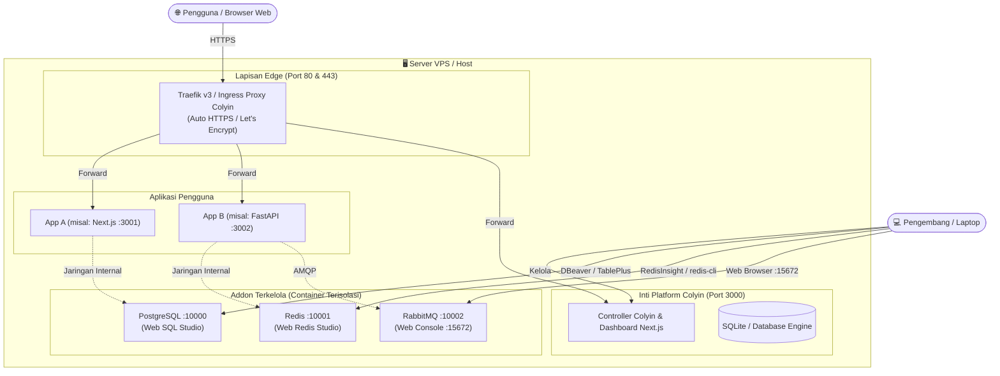

<p align="center">
  
</p>

<h1 align="center">Colyin</h1>

<p align="center">
  <strong>PaaS Self-Hosted & Mesin Serverless Modern</strong><br />
  Alternatif ringan dan ramah pengembang untuk Coolify, Railway, dan Vercel untuk self-hosting aplikasi, database, dan message broker di server VPS Anda sendiri.
</p>

<p align="center">
  
  
  
  
  
  
  
  
  <a href="https://github.com/Din-27/Colyin.Serverless.App/releases"></a>
</p>

<p align="center">
  <a href="./README.md">English</a> | <a href="./README.id.md"><strong>Bahasa Indonesia</strong></a>
</p>

---

## 🌟 Ringkasan

**Colyin** adalah Platform-as-a-Service (PaaS) *self-hosted all-in-one* yang dirancang untuk memberikan pengalaman deployment yang mudah dan instan layaknya platform cloud modern (seperti Vercel dan Railway) di server VPS atau bare-metal Anda sendiri, tanpa kerumitan konfigurasi Kubernetes.

Cukup hubungkan repositori Git Anda, dan Colyin akan menangani proses cloning kode sumber, deteksi stack teknologi, kompilasi container, penerbitan sertifikat SSL otomatis, jaringan internal mesh, hingga routing reverse proxy secara otomatis.

---

## ✨ Fitur Utama

### 🤖 Integrasi AI Model Context Protocol (MCP)
- **Antarmuka AI Penuh:** Server standar **Model Context Protocol (MCP)** bawaan yang tersedia di `/api/mcp`.
- **Operasional Mandiri (Otonom):** Memungkinkan tools coding berbasis AI (Cursor, Claude Desktop, Antigravity, ChatGPT) untuk secara otomatis melihat daftar proyek, memeriksa live logs Docker container, melakukan deployment, merestart aplikasi, hingga memonitor telemetri cluster.

### 🚀 CI/CD Otomatis via Git & Docker Logs
- **Deployment Sekali Klik:** Deploy langsung dari repositori GitHub (Publik maupun Privat).
- **Git Push Webhooks:** Build dan deployment otomatis setiap kali Anda melakukan push ke branch target.
- **Inspeksi Docker Logs:** Pantau log runtime container secara real-time langsung di konsol aplikasi.
- **Manajemen Versi Aplikasi:** Pelacakan versi rilis dan metadata aktif container aplikasi.

### 🧠 Deteksi Stack Pintar & Auto-Buildpack
- Deteksi otomatis bahasa & framework untuk **Node.js (Next.js, Vite, Express, NestJS)**, **Python (FastAPI, Django, Flask)**, **Go**, **PHP**, dan **Static Sites**.
- **Sintesis Dockerfile Universal:** Menghasilkan multi-stage production Dockerfile secara otomatis apabila repositori Anda belum memilikinya.

### 🗄️ Addon Terisolasi & Akses Publik Universal
Semua addon berjalan sebagai **instance yang terisolasi penuh** dengan fitur **Akses Publik & Alokasi Port Eksternal 1-Klik**:
- 🐘 **PostgreSQL:** Instance database mandiri dengan fitur bawaan **Web SQL Studio**, URL JDBC DBeaver, dan command CLI terminal.
- ⚡ **Redis:** In-memory cache berkecepatan tinggi dengan **Web Redis Studio**, konsol RESP CLI, dan snippet koneksi `redis-cli`.
- 🐰 **RabbitMQ:** Message broker AMQP dengan akses 1-klik langsung ke **Web Management Console** resmi (`http://<host>:15672`).
- 🐬 **MySQL 8:** Database relasional dengan skema otomatis, URL JDBC DBeaver, dan snippet koneksi CLI.
- 🪣 **MinIO:** Penyimpanan objek berperforma tinggi yang kompatibel dengan protokol S3 lengkap dengan web console.

### ⚡ Arsitektur Smart Dual-Engine & Standardisasi pnpm
- **Paket Manajer Ketat `pnpm`:** Terstandarisasi 100% menggunakan `pnpm` di Docker, lingkungan pengembangan lokal, dan server runtime untuk build yang sangat cepat dan bebas duplikasi dependensi.
- **Mode Produksi (Docker Online):** Menjalankan container resmi OCI Docker (`postgres:16-alpine`, `redis:7-alpine`, `rabbitmq:3-management-alpine`, `mysql:8.0`), jaringan bridge terisolasi, dan kuota cgroups v2 untuk CPU/RAM.
- **Mode Pengembangan (Local Standalone):** Fallback otomatis ke bare-metal lokal saat Docker offline, memungkinkan pengembangan penuh di laptop tanpa beban memori Docker Desktop.

### 📈 Telemetri Sistem & Service Real-Time (Overview)
- Fitur bawaan **Task Manager / Activity Monitor** di halaman `/overview`.
- Grafik gelombang SVG real-time untuk utilisasi CPU Host, penggunaan RAM, dan kapasitas penyimpanan hard disk (HDD/SSD).
- Tabel proses interaktif untuk seluruh aplikasi dan database addon Colyin yang aktif dengan indikator port, batas kuota memori, dan tombol pintasan pengelolaan langsung.

### 🌐 Ingress & Reverse Proxy Otomatis
- Reverse proxy terintegrasi yang mendengarkan **Port 80 (HTTP) dan 443 (HTTPS)**.
- **Domain Tanpa Konfigurasi:** Subdomain wildcard otomatis via `*.sslip.io` menggunakan IP Publik VPS Anda, atau arahkan domain kustom milik Anda sendiri.
- Terminasi SSL transparan dengan pembaruan sertifikat otomatis dari Let's Encrypt.

### 👥 Kolaborasi Tim & Keamanan RBAC
- Hak akses berbasis peran yang granular: **Admin**, **Developer**, dan **Viewer**.
- Halaman login modern single-card dengan pembuatan otomatis file kredensial root host server (`/opt/colyin/colyin-credentials.txt`).
- Seluruh token rahasia dan kata sandi database dienkripsi saat disimpan (*at rest*) menggunakan algoritma **AES-256-GCM**.

---

## 🏷️ Riwayat Release Tags & Changelog

| Tag | Status | Sorotan Fitur | Catatan Rilis |
| :--- | :--- | :--- | :--- |
| [**`v1.1.0`**](https://github.com/Din-27/Colyin.Serverless.App/releases/tag/v1.1.0) | **Rilis Terbaru** | AI Server Model Context Protocol (MCP), Akses Publik Universal Addon, Docker Logs, Standarisasi `pnpm` | [Lihat Catatan](#-v110---mcp-ai-server-akses-publik-universal-addon--migrasi-pnpm) |
| [**`v1.0.0`**](https://github.com/Din-27/Colyin.Serverless.App/releases/tag/v1.0.0) | Stabil | Rilis Produksi Resmi dengan Inti PaaS, Ingress Traefik v3, Git CI/CD | [Lihat Catatan](#-v100---rilis-produksi-resmi) |

### 🚀 v1.1.0 - MCP AI Server, Akses Publik Universal Addon & Migrasi pnpm
- **Model Context Protocol (MCP) Server (`/api/mcp`):** Antarmuka AI native yang memungkinkan Cursor, Claude, Antigravity, dan ChatGPT untuk menginspeksi proyek, membaca live Docker logs, melakukan deploy, dan merestart service secara otonom.
- **Akses Publik Universal untuk Addon:** Alokasi port publik 1-klik (`0.0.0.0:{publicPort}`) untuk PostgreSQL, Redis, RabbitMQ, MySQL 8, dan MinIO S3 dengan URL JDBC DBeaver, command CLI terminal siap copy, dan Web Console RabbitMQ.
- **Inspeksi Docker Container Logs:** Penampil log runtime container langsung di dalam console dashboard aplikasi.
- **Manajemen Versi Aplikasi:** Pelacakan nomor versi deployment aktif dan metadata container.
- **Standarisasi Penuh `pnpm`:** Standarisasi 100% menggunakan `pnpm` di Docker, environment lokal, dan CI/CD pipeline.
- **Arsitektur Bersih React Context:** Pemisahan komponen monolitik besar ke dalam sub-direktori bersih berbasis `useContext`.
- **Desain Modern Tailwind & Shadcn UI:** Tampilan halaman login single-card yang rapi dengan auto-generasi kredensial host (`/opt/colyin/colyin-credentials.txt`).

### 📦 v1.0.0 - Rilis Produksi Resmi
- **Inti Mesin PaaS:** Kloning repositori Git otomatis, deteksi stack teknologi, dan sintesis buildpack container.
- **Routing Edge & SSL:** Reverse proxy otomatis Traefik v3 dengan sertifikat Let's Encrypt dan subdomain wildcard `*.sslip.io`.
- **Smart Dual-Engine:** Orkestrasi container OCI Docker di server dengan fallback lokal standalone.
- **Telemetri Sistem:** Grafik gelombang real-time utilisasi CPU, RAM, dan disk host di `/overview`.
- **RBAC & Keamanan:** Enkripsi AES-256-GCM untuk seluruh token rahasia dan kata sandi database.

---

## 🏛️ Arsitektur Sistem



---

## 🔌 Referensi Port Default

| Service | Protokol | Port Default | Keterangan |
| :--- | :--- | :--- | :--- |
| **Colyin Dashboard** | HTTP/HTTPS | `3050` | Panel kontrol web & antarmuka manajemen (dapat diubah via `PORT`) |
| **Ingress HTTP** | HTTP | `80` | Router edge reverse proxy |
| **Ingress HTTPS** | HTTPS | `443` | Reverse proxy SSL/TLS wildcard |
| **PostgreSQL** | Wire (PGlite / Docker) | `10000` | Port database mandiri (DBeaver / Prisma) |
| **Redis** | RESP Wire | `10001` | Port cache mandiri (ioredis / RedisInsight) |
| **RabbitMQ AMQP** | AMQP 0-9-1 | `10002` | Message queue worker protocol |
| **RabbitMQ Web UI** | HTTP | `15672` | Konsol Web Manajemen resmi RabbitMQ |
| **MySQL 8** | Protokol MySQL | `3306` (atau publik dinamis) | Database relasional (DBeaver / mysql-client) |
| **MinIO S3 / Console** | HTTP | `9000 / 9001` | S3 API & Web Object Browser Console |
| **Colyin MCP Server** | HTTP / JSON | `:3050/api/mcp` | API Model Context Protocol untuk otomasi agen AI |

---

## 🚀 Panduan Instalasi & Quick Start

### 📖 Tutorial Pemasangan Lengkap di Server VPS (Step-by-Step)

Panduan ini ditujukan bagi Anda yang ingin memasang Colyin dari nol di server VPS baru (seperti DigitalOcean, AWS EC2, IDCloudHost, Hetzner, Contabo, Linode, atau Vultr).

#### Langkah 1: Persiapan VPS & Konfigurasi Firewall
Pastikan server Anda menggunakan **Ubuntu 22.04 LTS atau 24.04 LTS**. Di panel cloud provider Anda (Security Groups / Firewall), pastikan port-port berikut diizinkan masuk (*Inbound Allow*):
* `22` (SSH)
* `80` & `443` (HTTP & HTTPS Ingress Reverse Proxy)
* `3050` (Web Dashboard Colyin — dapat diubah via `PORT`)
* `10000 - 10020` (Rentang Publik untuk PostgreSQL & Redis)
* `15672` (Konsol Web Manajemen RabbitMQ)

#### Langkah 2: Hubungkan ke VPS via SSH
Buka terminal di komputer Anda, lalu masuk ke VPS:
```bash
ssh root@ip_vps_anda
```

#### Langkah 3: Clone Repositori Colyin dari GitHub
Download kode sumber Colyin ke direktori `/opt/colyin`:
```bash
git clone https://github.com/Din-27/Colyin.Serverless.App.git /opt/colyin
cd /opt/colyin
```

#### Langkah 4: Jalankan Script Pemasangan Otomatis (1 Perintah)
Jalankan script installer bawaan Colyin:
```bash
bash install.sh
```

**Proses yang berjalan secara otomatis:**
1. Memperbarui package sistem apt dan memasang curl, git, serta paket pendukung.
2. Memasang Docker Engine & Docker Compose resmi versi terbaru (apabila belum terpasang).
3. Mengonfigurasi rule firewall UFW pada server.
4. Mendeteksi IP Publik VPS Anda secara otomatis dan membuat file `.env` produksi dengan master key enkripsi AES-256 acak.
5. Membangun container dan menjalankan Colyin di latar belakang menggunakan Docker Compose.

#### Langkah 5: Buka Dashboard & Buat Akun Administrator Pertama
1. Buka browser di laptop Anda dan akses:
   ```text
   http://<ip_vps_anda>:3050
   ```
2. Anda akan disambut oleh halaman registrasi awal / setup.
3. Daftarkan akun utama Anda. **Pengguna pertama yang mendaftar secara otomatis diberikan hak akses `ADMIN` penuh.**

#### Langkah 6: Konfigurasi Domain Publik (Settings)
1. Di dashboard Colyin, buka menu **Settings** pada navbar atas.
2. Periksa kolom **Wildcard Domain**:
   * **Jika tidak memiliki nama domain pribadi:** Cukup biarkan terisi default `<ip_vps_anda>.sslip.io`. Setiap aplikasi yang Anda deploy langsung dapat diakses publik dari internet.
   * **Jika memiliki nama domain sendiri (misal `apps.domainanda.com`):**
     * Di penyedia DNS domain Anda (Cloudflare, Niagahoster, dll.), tambahkan **DNS A Record**: `*.apps` mengarah ke IP VPS Anda.
     * Masukkan `apps.domainanda.com` pada kolom Wildcard Domain di menu Settings Colyin, lalu klik **Save Settings**.

#### Langkah 7: Deploy Service Pertama & Database Addon
1. Pada menu **Projects**, buat project baru (misal: `production`).
2. **Deploy Aplikasi:**
   * Klik **"New Service"** &rarr; masukkan URL repositori Git Anda (Publik atau Privat).
   * Klik **"Deploy"**. Sistem akan otomatis mendeteksi stack, mengompilasi OCI container, dan memberikan URL HTTPS aktif.
3. **Tambah Database / Message Broker:**
   * Klik **"New Addon"** &rarr; pilih **PostgreSQL**, **Redis**, atau **RabbitMQ**.
   * Buka kartu addon untuk melihat connection string dan mengakses **Web SQL Studio**, **Web Redis Studio**, atau **RabbitMQ Management Console** (`http://<ip_vps>:15672`).

---

### Opsi 2: Deployment via Docker Compose

Jika server Anda sudah memiliki Docker dan Docker Compose:

1. Clone repositori:
   ```bash
   git clone https://github.com/Din-27/Colyin.Serverless.App.git colyin
   cd colyin
   ```

2. Konfigurasikan environment:
   ```bash
   cp .env.example .env
   ```
   *(Pastikan `PUBLIC_IP` dan `WILDCARD_DOMAIN` telah diatur sesuai IP atau domain server Anda).*

3. Jalankan service:
   ```bash
   docker compose up -d --build
   ```

---

### Opsi 3: Development Lokal (Tanpa Docker)

Anda dapat menjalankan Colyin secara lokal di Windows, macOS, atau Linux tanpa harus menginstal Docker Desktop menggunakan **pnpm**:

1. Clone repositori dan instal dependensi:
   ```bash
   git clone https://github.com/Din-27/Colyin.Serverless.App.git colyin
   cd colyin
   pnpm install
   ```

2. Inisialisasi skema database:
   ```bash
   pnpm exec prisma generate
   pnpm exec prisma db push
   ```

3. Jalankan server lokal & daemon pendukung:
   ```bash
   # Terminal 1: Frontend Next.js & REST API
   pnpm dev

   # Terminal 2: Background Addons Engine (PostgreSQL, Redis, RabbitMQ)
   pnpm addons

   # Terminal 3: Ingress Reverse Proxy (Port 80/443)
   pnpm ingress
   ```

4. Buka **`http://localhost:3050`** di browser Anda.

---

## 🔄 Panduan Memperbarui (Upgrade / Update) Colyin di VPS

Ketika ada pembaruan fitur, rilis versi baru, atau patch keamanan, Anda dapat memperbarui instalasi Colyin di server VPS Anda secara aman dan instan tanpa kehilangan data.

> [!NOTE]
> **Jaminan Keamanan Data (Zero Data Loss):**
> Database Colyin disimpan secara persisten di folder host `./data/prod.db` dan kunci enkripsi tersimpan di file `.env`. Menjalankan proses update **TIDAK AKAN MENGHAPUS** project, aplikasi, database addon (PostgreSQL, Redis, RabbitMQ), sertifikat SSL, maupun akun pengguna Anda.

### Cara 1: Update Cepat via Git & Docker Compose (Rekomendasi)
Buka terminal dan hubungkan ke VPS Anda via SSH, lalu jalankan:

```bash
# 1. Masuk ke direktori instalasi Colyin
cd /opt/colyin

# 2. Ambil kode terbaru dari repositori Git
git pull

# 3. Rebuild dan restart container Colyin di latar belakang
docker compose up -d --build
```

Proses update ini umumnya selesai dalam 30–60 detik. Setelah container baru aktif, Anda dapat langsung me-refresh browser.

---

### Cara 2: Update via Script Installer
Anda juga dapat mengeksekusi kembali script installer bawaan Colyin:

```bash
cd /opt/colyin
bash install.sh
```

Script installer secara otomatis mendeteksi keberadaan file `./data/prod.db` dan `.env`, sehingga sistem akan mempertahankan konfigurasi yang ada dan hanya memperbarui image container ke versi terbaru.

---

### 🔧 Perintah Perawatan & Pemeliharaan Server

Perintah-perintah terminal yang sering digunakan saat mengelola Colyin di `/opt/colyin`:

```bash
# Melihat status seluruh container Colyin
docker compose ps

# Memantau realtime logs controller Colyin & reverse proxy
docker compose logs -f

# Me-restart seluruh service Colyin
docker compose restart

# Menghentikan service Colyin sementara
docker compose down
```

---

## 🗑️ Cara Uninstall (Menghapus) Colyin dari Server VPS

Jika Anda ingin mencopot atau menghapus instalasi Colyin dari server VPS Anda, Anda dapat menggunakan script uninstaller otomatis bawaan atau menjalankan perintah manual, dengan opsi mempertahankan data atau menghapus seluruhnya secara bersih (*complete purge*).

### Opsi 1: Menggunakan Script Uninstall Otomatis (Rekomendasi)
Masuk ke direktori instalasi Colyin dan jalankan uninstaller bawaan:

```bash
cd /opt/colyin
sudo bash uninstall.sh
```
- Script interaktif ini akan menanyakan konfirmasi dan memberi pilihan apakah Anda ingin mempertahankan database (`./data/prod.db`), file penyimpanan (`./apps-storage`), serta rahasia (`.env`), atau menghapus seluruhnya secara permanen.
- Untuk penghapusan total secara otomatis tanpa konfirmasi interaktif (misal pada script otomatisasi/teardown server):
  ```bash
  sudo bash uninstall.sh --yes --purge-data
  ```

---

### Opsi 2: Uninstall Manual via Terminal

Jika Anda ingin menghapusnya secara manual menggunakan perintah standar Docker dan Linux:

#### 1. Hentikan dan hapus seluruh container, network, dan volume:
```bash
cd /opt/colyin
# Hentikan controller inti Colyin & Traefik
docker compose down -v --remove-orphans

# Hentikan seluruh container aplikasi pengguna & database addon yang dibuat oleh Colyin
docker ps -a --filter "network=minipaas-global" -q | xargs -r docker rm -f

# Hapus jaringan bridge internal Colyin
docker network rm minipaas-global 2>/dev/null || true
```

#### 2. Hapus direktori dan seluruh berkas Colyin:
```bash
# Menghapus seluruh folder Colyin beserta database dan file konfigurasinya:
cd /opt
sudo rm -rf /opt/colyin
```

#### 3. (Opsional) Tutup Kembali Port Firewall UFW:
Jika Anda tidak lagi membutuhkan port-port yang sebelumnya dibuka:
```bash
sudo ufw delete allow 3050/tcp
sudo ufw delete allow 15672/tcp
sudo ufw delete allow 10000:10020/tcp
sudo ufw reload
```

---

## ⚙️ Konfigurasi Environment (`.env`)

| Variabel | Nilai Bawaan | Keterangan |
| :--- | :--- | :--- |
| `NODE_ENV` | `production` | Set ke `production` pada server aktif |
| `PORT` | `3050` | Port host untuk akses dashboard langsung (mencegah tabrakan dengan port 3000) |
| `PUBLIC_IP` | `localhost` | IP Publik VPS untuk koneksi remote database |
| `WILDCARD_DOMAIN` | `127.0.0.1.sslip.io` | Domain dasar wildcard (misal `103.xxx.sslip.io` atau `apps.domain.com`) |
| `ENCRYPTION_MASTER_KEY`| *(dibuat otomatis)* | Master key heksadesimal 64 karakter untuk enkripsi AES-256-GCM |
| `DATABASE_URL` | `file:./dev.db` | Jalur file database SQLite |
| `ADMIN_ALERT_EMAIL` | `admin@example.com` | Email penerima notifikasi dan alert sistem |
| `GITHUB_CLIENT_ID` | *(opsional)* | Client ID GitHub OAuth App untuk repositori privat |
| `GITHUB_CLIENT_SECRET`| *(opsional)* | Client Secret GitHub OAuth App |

---

## 🔐 Kredensial, Keamanan & Akun Admin Pertama

Colyin menerapkan standar keamanan tingkat enterprise untuk instalasi mandiri:

### 1. Kredensial Master Unik (Dibuat Otomatis)
Saat Colyin diinisialisasi pertama kali pada VPS baru:
- Sistem secara otomatis membuat akun Administrator pertama dengan **password acak berkekuatan tinggi** (16 karakter gabungan alfanumerik dan simbol).
- Kredensial ini otomatis disimpan ke dalam file lokal:
  ```bash
  cat /opt/colyin/colyin-credentials.txt
  ```
- File ini terlindungi dan hanya dapat dibaca oleh pengguna dengan akses root/sudo di server Anda.
- Pada mode `production`, **tidak ada akun dummy atau kredensial contoh yang bocor** ke publik.

### 2. Cara Reset / Mengubah Password Admin via CLI
Jika Anda lupa password administrator atau ingin menggantinya langsung dari terminal server:
```bash
node scripts/reset-admin-password.js admin@colyin.local PasswordBaru123!
```
Password baru akan langsung di-hash menggunakan BCrypt dan file `colyin-credentials.txt` akan diperbarui secara otomatis.

### 3. Role-Based Access Control (RBAC) & Kolaborator
Administrator dapat mengundang kolaborator tim di menu **Settings -> Team & Users**:
- **ADMIN:** Hak penuh untuk mengelola pengguna, menghapus project, mengubah domain global, dan mengonfigurasi alert sistem.
- **DEVELOPER:** Dapat membuat, mendeploy, dan mengonfigurasi aplikasi serta database addon.
- **VIEWER:** Akses *read-only* untuk memantau status aplikasi, metrik telemetri, dan build logs tanpa izin mengubah konfigurasi.

---

## ⚡ Panduan Setup Auto-Deploy GitHub Webhook

Colyin mendukung continuous deployment (CI/CD) otomatis langsung dari GitHub tanpa menghabiskan kuota menit GitHub Actions Anda:

### Langkah-langkah Konfigurasi:
1. Buka repositori Anda di GitHub, lalu klik tab **Settings** &rarr; **Webhooks** &rarr; **Add webhook**.
2. Masukkan konfigurasi berikut:
   - **Payload URL:** `https://<domain-colyin-anda>/api/webhooks/github` (atau `http://<ip-vps>:3000/api/webhooks/github`)
   - **Content type:** Pilih `application/json`
   - **Secret:** *(Opsional)* Jika Anda menyetel `GITHUB_WEBHOOK_SECRET` di `.env`, masukkan nilai yang sama di sini.
   - **Which events would you like to trigger this webhook?:** Pilih **Just the push event**.
   - **Active:** Pastikan dicentang.
3. Klik **Add webhook**.
4. Selesai! Setiap kali Anda menjalankan `git push` ke branch utama (atau branch yang ditentukan), GitHub akan mengirim sinyal webhook ke Colyin, dan server Colyin akan langsung men-clone kode terbaru, mengompilasi container, dan me-restart aplikasi tanpa downtime.

---

## 🔑 Deploy Repositori Git Privat

Untuk men-deploy repositori privat dari GitHub atau GitLab:
1. **Menggunakan Personal Access Token (PAT):**
   - Buat Fine-Grained atau Classic PAT di GitHub (`Settings -> Developer settings -> Personal access tokens`) dengan izin cakupan `repo:read`.
   - Di Colyin saat menambahkan Service, masukkan Git URL dengan format:
     ```text
     https://<TOKEN>@github.com/username/private-repo.git
     ```
   - Atau simpan sebagai environment variable aplikasi dengan nama `GIT_AUTH_TOKEN`. Colyin mengenkripsi token ini menggunakan **AES-256-GCM** sebelum disimpan ke database.
2. **Menggunakan GitHub OAuth App:**
   - Masukkan `GITHUB_CLIENT_ID` dan `GITHUB_CLIENT_SECRET` Anda di menu **Settings -> GitHub OAuth**.
   - Colyin akan mengautentikasi akses repositori secara native.

---

## 📚 Edisi Platform: Core vs Cloud

Colyin hadir dalam dua edisi yang saling melengkapi:
- **Colyin Core (Repositori Ini):** Edisi murni self-hosted open-source tanpa beban landing page promosi. Langsung masuk ke console inti setelah login untuk mengelola server dan cluster Anda sendiri.
- **Colyin Cloud (`colyin-cloud`):** Layanan cloud computing terkelola (SaaS PaaS) siap pakai bagi mereka yang ingin mendeploy tanpa harus menyewa atau memelihara server VPS sendiri. Dilengkapi landing page modern cyberpunk, dokumentasi interaktif, dan cluster multi-region.

---

## 🔌 Port & Akses Addon Terkelola

| Addon | Protokol | Port Internal / Host | Konsol Web GUI | Kredensial Default |
| :--- | :--- | :--- | :--- | :--- |
| **PostgreSQL** | TCP / Wire | `10000` | Web SQL Studio Bawaan | Dibuat otomatis per database |
| **Redis** | RESP / TCP | `10001` | Web Redis Studio CLI Bawaan | `colyin_redis_secret` |
| **RabbitMQ** | AMQP / TCP | `10002` | `http://localhost:15672` | `guest` / `guest` |
| **Ingress HTTP** | HTTP | `80` | Router Otomatis | N/A |
| **Ingress HTTPS**| HTTPS | `443` | Sertifikat TLS Otomatis | N/A |

---

## 🌐 Referensi Cepat Endpoint REST API

| Method | Endpoint | Keterangan |
| :--- | :--- | :--- |
| `GET` | `/api/system/status` | Status daemon Docker dan telemetri resource |
| `GET` | `/api/system/metrics` | Metrik utilisasi CPU, RAM, dan Disk secara real-time |
| `GET` | `/api/auth/me` | Informasi payload sesi yang terautentikasi & role RBAC |
| `POST` | `/api/auth/login` | Otentikasi dengan email dan kata sandi |
| `POST` | `/api/projects` | Membuat jaringan virtual project terisolasi baru |
| `POST` | `/api/applications` | Membuat dan mengaitkan aplikasi ke canvas project |
| `POST` | `/api/deployments/trigger` | Menjalankan build dan deployment container asynchronous |
| `GET` | `/api/addons/redis/keys` | Menjelajah daftar key Redis dan nilai cache aktif |
| `POST` | `/api/addons/redis/cli` | Menjalankan perintah RESP mentah pada engine Redis aktif |

---

## 🛠️ Troubleshooting & Panduan Masalah Deployment

Jika Anda mengalami kendala saat mengakses aplikasi setelah deployment (seperti **404 Page Not Found** atau **502 Bad Gateway**), silakan baca panduan pemecahan masalah lengkap di:

👉 **[Panduan Lengkap Troubleshooting Deployment (docs/TROUBLESHOOTING-DEPLOYMENT-ACCESS.md)](./docs/TROUBLESHOOTING-DEPLOYMENT-ACCESS.md)**

Panduan tersebut mencakup:
- **Peran Wajib `minipaas-controller`:** Mengapa controller harus aktif untuk mengelola jaringan mesh, Docker labels, dan build lifecycle.
- **Docker Client API Mismatch (Error 404):** Solusi upgrade ke Traefik v3.6 dan `DOCKER_API_VERSION=1.44`.
- **Port Mismatch & Binding Address 0.0.0.0 (Error 502 Bad Gateway):** Memastikan aplikasi mengikat ke `0.0.0.0:${PORT}` secara dinamis.
- **Arsitektur Nginx di Depan, Traefik di Belakang:** Cara menghindari konflik port jika server VPS Anda sudah memiliki Nginx aktif di port 80/443.
- **Checklist Diagnostik Cepat:** Perintah CLI untuk memverifikasi status Traefik, network mesh, dan internal connectivity.

---

## 🤖 Otomasi AI dengan Model Context Protocol (MCP)

Colyin menyediakan endpoint server **Model Context Protocol (MCP)** bawaan di `/api/mcp` yang memungkinkan AI coding assistant dan agent (seperti **Cursor**, **Claude Desktop**, **Antigravity**, **ChatGPT**, dan **GitHub Copilot**) untuk memeriksa, menginspeksi, dan mengelola cluster Anda secara otonom.

### Daftar MCP Tools yang Tersedia:
| Nama Tool | Deskripsi |
| :--- | :--- |
| `colyin_list_projects` | Menampilkan seluruh proyek, jumlah aplikasi, database addon, dan jaringan internal |
| `colyin_list_applications` | Menampilkan seluruh aplikasi beserta versi, status, dan port aktif |
| `colyin_get_application` | Inspeksi detail aplikasi mencakup domain, environment keys, dan container aktif |
| `colyin_get_docker_logs` | Mengambil live runtime logs container Docker secara langsung |
| `colyin_deploy_application` | Menjalankan pipeline build dan deployment baru dari Git |
| `colyin_restart_application` | Merestart container Docker aplikasi target secara aman |
| `colyin_stop_application` | Menghentikan container aplikasi target |
| `colyin_docker_prune` | Menjalankan pembersihan cache dan builder Docker yang tidak terpakai |
| `colyin_get_system_telemetry`| Mengambil telemetri real-time CPU, RAM, disk host, dan status daemon |

### Contoh Konfigurasi (Cursor / Claude Desktop / Antigravity):
```json
{
  "mcpServers": {
    "colyin": {
      "url": "http://<IP_VPS_ANDA>:3050/api/mcp"
    }
  }
}
```

---

## 🤝 Berkontribusi ke Open Source

Colyin adalah perangkat lunak open-source 100% di bawah naungan **Lisensi MIT**. Kami menyambut kontribusi dari para pengembang di seluruh dunia!

### Cara Berkontribusi:
1. **Fork Repositori** di GitHub.
2. **Buat Feature Branch Baru:** `git checkout -b feature/fitur-keren`.
3. **Commit perubahan Anda:** `git commit -m 'feat: menambahkan fitur keren'`.
4. **Push ke Branch Anda:** `git push origin feature/fitur-keren`.
5. **Buat Pull Request (PR)** dengan menjelaskan rincian perubahan serta pengujian yang telah dilakukan.

### Panduan Pengembangan:
- Pastikan standar kode bersih dengan menjalankan `pnpm run lint`.
- Verifikasi tipe TypeScript tanpa error menggunakan `pnpm exec tsc --noEmit`.

---

## ☕ Dukung Pengembang / Trakter Kopi

Jika Colyin bermanfaat bagi proyek atau workflow deployment Anda, Anda bisa mendukung pengembangan berkelanjutan dan biaya server dengan mentrakter developer:

👉 **[Trakter Developer via SociaBuzz Tribe](https://sociabuzz.com/herdin27/tribe)**

Dukungan Anda sangat berarti untuk terus menambahkan fitur baru dan menjaga Colyin tetap open-source dan bebas digunakan!

---

## 📄 Lisensi

Proyek ini dilisensikan di bawah [Lisensi MIT](LICENSE) &mdash; bebas digunakan, dimodifikasi, di-self-host, dan didistribusikan.
Colyin dibangun oleh pengembang, untuk pengembang.

