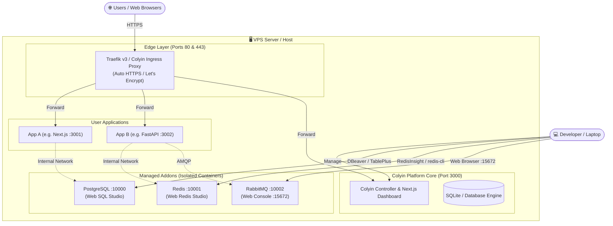

<p align="center">
  
</p>

<h1 align="center">Colyin</h1>

<p align="center">
  <strong>Self-Hosted PaaS & Modern Serverless Engine</strong><br />
  A lightweight, developer-friendly alternative to Coolify, Railway, and Vercel for self-hosting apps, databases, and message brokers on any server.
</p>

<p align="center">
  
  
  
  
  
  
</p>

<p align="center">
  <a href="./README.md"><strong>English</strong></a> | <a href="./README.id.md">Bahasa Indonesia</a>
</p>

---

## 🌟 Overview

**Colyin** is an all-in-one, self-hosted Platform-as-a-Service (PaaS) designed to give developers the effortless deployment experience of modern cloud platforms (like Vercel and Railway) on their own VPS or bare-metal server, without the operational complexity of Kubernetes.

Connect your Git repository, and Colyin handles source code cloning, stack detection, container compilation, SSL certificate provisioning, internal mesh networking, and reverse proxy routing automatically.

---

## ✨ Key Features

### 🚀 Automated Git CI/CD
- **One-Click Deployments:** Deploy directly from GitHub repositories (Public and Private).
- **Git Push Webhooks:** Trigger automated builds and deployments on every push to your target branch.
- **Real-Time Telemetry:** Stream live build logs and runtime health checks via SSE.

### 🧠 Smart Stack Detection & Auto-Buildpack
- Automatic language & framework detection for **Node.js (Next.js, Vite, Express, NestJS)**, **Python (FastAPI, Django, Flask)**, **Go**, **PHP**, and **Static Sites**.
- **Universal Dockerfile Synthesis:** Automatically generates multi-stage production Dockerfiles if your repository does not include one.

### 🗄️ Dedicated Addons & Managed Databases
All addons run as **fully dedicated, isolated instances** (no shared data, dedicated ports, unique persistent volumes, and encrypted passwords):
- 🐘 **PostgreSQL:** Dedicated database instance with built-in **Web SQL Studio** in the browser (execute queries without installing DBeaver or JDBC drivers).
- ⚡ **Redis:** Ultra-fast in-memory cache with built-in **Web Redis Studio & Cache Inspector** (Key-Value explorer, real-time memory metrics, and live RESP CLI console).
- 🐰 **RabbitMQ:** AMQP message broker on port `10002` + official **Web Management Console** on port `15672` (`http://localhost:15672`).
- 🪣 **MinIO:** High-performance S3-compatible object storage with web management console.

### ⚡ Smart Dual-Engine Architecture
- **Production Mode (Docker Online):** Deploys official OCI Docker containers (`postgres:16-alpine`, `redis:7-alpine`, `rabbitmq:3-management-alpine`), isolated bridge networks, and CPU/RAM cgroups v2 quotas.
- **Development Mode (Local Standalone):** Seamless bare-metal fallback when Docker is offline, enabling full development on laptops without the memory overhead of Docker Desktop.

### 📈 Real-Time System & Service Telemetry (Overview)
- Built-in **Task Manager / Activity Monitor** at `/overview`.
- Real-time SVG waveform charts for Host CPU utilization, RAM consumption, and HDD disk space.
- Interactive live process table for all running Colyin applications and database addons with port indicators, memory limits, and direct management shortcuts.

### 🌐 Automated Ingress & Reverse Proxy
- Integrated reverse proxy listening on **Ports 80 (HTTP) and 443 (HTTPS)**.
- **Zero-Config Domains:** Automatic wildcard subdomains via `*.sslip.io` using your server's public IP, or point your own custom domain.
- Transparent SSL termination with automated Let's Encrypt certificates.

### 👥 Team Collaboration & RBAC Security
- Granular permissions with **Admin**, **Developer**, and **Viewer** roles.
- All sensitive tokens and database passwords are encrypted at rest using **AES-256-GCM**.

---

## 🏛️ System Architecture



---

## 🔌 Default Port Reference

| Service | Protocol | Default Port | Description |
| :--- | :--- | :--- | :--- |
| **Colyin Dashboard** | HTTP/HTTPS | `3000` | Web control panel & management UI |
| **Ingress HTTP** | HTTP | `80` | Reverse proxy edge router |
| **Ingress HTTPS** | HTTPS | `443` | SSL/TLS wildcard reverse proxy |
| **PostgreSQL** | Wire (PGlite / Docker) | `10000` | Dedicated database port (DBeaver / Prisma) |
| **Redis** | RESP Wire | `10001` | Dedicated cache port (ioredis / RedisInsight) |
| **RabbitMQ AMQP** | AMQP 0-9-1 | `10002` | Message queue worker protocol |
| **RabbitMQ Web UI** | HTTP | `15672` | Official RabbitMQ Web Management Console |

---

## 🚀 Installation & Quick Start

### 📖 Step-by-Step VPS Installation Guide

This guide is for installing Colyin on a fresh VPS (such as DigitalOcean, AWS EC2, Hetzner, Linode, Contabo, or Vultr).

#### Step 1: VPS Prerequisites & Firewall Setup
Ensure your server runs **Ubuntu 22.04 LTS or 24.04 LTS**. In your cloud provider's security group / firewall settings, make sure the following ports are open (*Inbound Allow*):
* `22` (SSH)
* `80` & `443` (HTTP & HTTPS Ingress Reverse Proxy)
* `3000` (Colyin Web Dashboard)
* `10000 - 10020` (Public Range for PostgreSQL & Redis)
* `15672` (RabbitMQ Web Management Console)

#### Step 2: Connect via SSH
Open your terminal and connect to your VPS:
```bash
ssh root@your_vps_ip
```

#### Step 3: Clone Colyin Repository
Clone the Colyin source code into `/opt/colyin`:
```bash
git clone https://github.com/Din-27/Colyin.Serverless.App.git /opt/colyin
cd /opt/colyin
```

#### Step 4: Run the Automated Installer (Single Command)
Execute the built-in installer script:
```bash
bash install.sh
```

**What the installer does automatically:**
1. Updates package repositories and installs curl, git, and prerequisites.
2. Installs the latest official Docker Engine & Docker Compose (if not already installed).
3. Configures UFW firewall rules.
4. Auto-detects your VPS public IP and creates a production `.env` file with an encrypted AES-256 master key.
5. Builds containers and starts Colyin in the background via Docker Compose.

#### Step 5: Access the Dashboard & Create Initial Admin Account
1. Open your browser and navigate to:
   ```text
   http://<your_vps_ip>:3000
   ```
2. You will be greeted by the initial setup / registration screen.
3. Register your primary account. **The first registered user is automatically granted full `ADMIN` privileges.**

#### Step 6: Configure Public Wildcard Domain
1. In the Colyin dashboard, navigate to **Settings** in the top navigation bar.
2. Review the **Wildcard Domain** field:
   * **If you do not have a custom domain:** Keep the default `<your_vps_ip>.sslip.io`. Every app deployed will be instantly reachable over the internet.
   * **If you own a custom domain (e.g. `apps.yourdomain.com`):**
     * In your DNS provider (Cloudflare, Namecheap, etc.), add an **A Record**: `*.apps` pointing to your VPS public IP.
     * Enter `apps.yourdomain.com` into the Wildcard Domain field in Colyin Settings, then click **Save Settings**.

#### Step 7: Deploy Your First Service & Database Addon
1. On the **Projects** page, create a new project (e.g. `production`).
2. **Deploy an Application:**
   * Click **"New Service"** &rarr; enter your Git repository URL (Public or Private).
   * Click **"Deploy"**. Colyin automatically detects your framework, compiles the container, and provisions a live URL.
3. **Provision a Database / Message Broker:**
   * Click **"New Addon"** &rarr; select **PostgreSQL**, **Redis**, or **RabbitMQ**.
   * Open the addon card to view connection details, or use **Web SQL Studio**, **Web Redis Studio**, or the **RabbitMQ Management Console** (`http://<your_vps_ip>:15672`).

---

### Option 2: Docker Compose Deployment

If you already have Docker and Docker Compose installed:

1. Clone repository:
   ```bash
   git clone https://github.com/Din-27/Colyin.Serverless.App.git colyin
   cd colyin
   ```

2. Configure environment:
   ```bash
   cp .env.example .env
   ```
   *(Ensure `PUBLIC_IP` and `WILDCARD_DOMAIN` are set to your server's IP or domain).*

3. Start services:
   ```bash
   docker compose up -d --build
   ```

---

### Option 3: Local Development (Without Docker)

You can run Colyin locally on Windows, macOS, or Linux without installing Docker Desktop:

1. Clone and install dependencies:
   ```bash
   git clone https://github.com/Din-27/Colyin.Serverless.App.git colyin
   cd colyin
   npm install
   ```

2. Initialize database schema:
   ```bash
   npx prisma generate
   npx prisma db push
   ```

3. Start local development server & daemons:
   ```bash
   # Terminal 1: Next.js Frontend & API
   npm run dev

   # Terminal 2: Background Addons Engine (PostgreSQL, Redis, RabbitMQ)
   npm run addons

   # Terminal 3: Ingress Reverse Proxy (Ports 80/443)
   npm run ingress
   ```

4. Open **`http://localhost:3000`** in your browser.

---

## 🔄 Updating Colyin on Your VPS

When new features, releases, or security patches are published, you can update your Colyin server seamlessly with zero data loss.

> [!NOTE]
> **Zero Data Loss Guarantee:**
> Colyin data is persistently stored on the host filesystem under `./data/prod.db` and encryption keys are preserved in `.env`. Updating **WILL NEVER DELETE** your projects, applications, database addons (PostgreSQL, Redis, RabbitMQ), SSL certificates, or user accounts.

### Method 1: Fast Update via Git & Docker Compose (Recommended)
Connect to your VPS via SSH and run:

```bash
# 1. Navigate to the Colyin directory
cd /opt/colyin

# 2. Pull the latest code updates
git pull

# 3. Rebuild and restart containers in the background
docker compose up -d --build
```

The update process typically completes in 30–60 seconds. Once completed, refresh your browser.

---

### Method 2: Update via Installer Script
You can also rerun the installer script:

```bash
cd /opt/colyin
bash install.sh
```

The script automatically detects existing `./data/prod.db` and `.env` files, preserving all existing configurations while updating container images.

---

### 🔧 Useful Server Maintenance Commands

Common administrative commands when working in `/opt/colyin`:

```bash
# View status of all Colyin containers
docker compose ps

# View live logs for Colyin controller & reverse proxy
docker compose logs -f

# Restart all Colyin services
docker compose restart

# Stop Colyin services temporarily
docker compose down
```

---

## 🗑️ Uninstalling Colyin from Your VPS

If you ever wish to remove Colyin from your server, you can choose between an automated uninstaller script or manual cleanup, with the option to preserve or completely purge your data.

### Option 1: Automated Script (Recommended)
Run the built-in uninstaller script from your installation directory:

```bash
cd /opt/colyin
sudo bash uninstall.sh
```
- The interactive script will ask whether you want to preserve or permanently purge your persistent database (`./data/prod.db`), app storage (`./apps-storage`), and secrets (`.env`).
- For non-interactive full removal (e.g. automated server teardown):
  ```bash
  sudo bash uninstall.sh --yes --purge-data
  ```

---

### Option 2: Manual Removal via Terminal

If you prefer to remove Colyin manually using standard Docker and Linux commands:

#### 1. Stop and remove all containers, networks, and volumes:
```bash
cd /opt/colyin
# Stop Colyin core controller & Traefik
docker compose down -v --remove-orphans

# Stop any running user application & database addon containers
docker ps -a --filter "network=minipaas-global" -q | xargs -r docker rm -f

# Remove the internal bridge network
docker network rm minipaas-global 2>/dev/null || true
```

#### 2. Remove files and data directories:
```bash
# To completely delete Colyin and all associated data:
cd /opt
sudo rm -rf /opt/colyin
```

#### 3. (Optional) Revert Firewall Ports:
If you no longer need the open firewall ports on UFW:
```bash
sudo ufw delete allow 3000/tcp
sudo ufw delete allow 15672/tcp
sudo ufw delete allow 10000:10020/tcp
sudo ufw reload
```

---

## ⚙️ Environment Configuration (`.env`)

| Variable | Default | Description |
| :--- | :--- | :--- |
| `NODE_ENV` | `development` | Set to `production` on live servers |
| `PUBLIC_IP` | `localhost` | Public IP of the VPS for remote database connections |
| `WILDCARD_DOMAIN` | `127.0.0.1.sslip.io` | Wildcard base domain (e.g. `103.xxx.sslip.io` or `apps.domain.com`) |
| `ENCRYPTION_MASTER_KEY`| *(auto-generated)* | 64-character hex master key for AES-256-GCM encryption |
| `DATABASE_URL` | `file:./dev.db` | SQLite database storage path |
| `ADMIN_ALERT_EMAIL` | `admin@example.com` | Notification recipient for system alerts |
| `GITHUB_CLIENT_ID` | *(optional)* | GitHub OAuth App client ID for private repos |
| `GITHUB_CLIENT_SECRET`| *(optional)* | GitHub OAuth App client secret |

---

## 🔐 Credentials, Security & Default Admin Setup

Colyin implements enterprise security standards for self-hosted environments:

### 1. Unique Master Credentials (Auto-Generated)
When Colyin is initialized on a new VPS:
- An initial Administrator account is provisioned with a **cryptographically secure random password** (16 alphanumeric and symbolic characters).
- These credentials are recorded locally in:
  ```bash
  cat /opt/colyin/colyin-credentials.txt
  ```
- This file is strictly restricted to root/sudo system access.
- In `production` mode, no default or sample credentials are ever exposed publicly.

### 2. Resetting / Changing Admin Password via CLI
If you need to reset the administrator password directly from the server terminal:
```bash
node scripts/reset-admin-password.js admin@colyin.local NewPassword123!
```
The new password is immediately hashed with BCrypt and synchronized to `colyin-credentials.txt`.

### 3. Role-Based Access Control (RBAC)
Administrators can invite collaborators in **Settings -> Team & Users**:
- **ADMIN:** Full authority to manage users, delete projects, modify global domains, and configure system alerts.
- **DEVELOPER:** Can create, deploy, and manage applications and database addons.
- **VIEWER:** Read-only access to monitor application status, telemetry metrics, and build logs without modification permissions.

---

## ⚡ GitHub Webhook Auto-Deploy Setup

Colyin supports continuous deployment directly from GitHub without consuming your GitHub Actions minutes:

### Setup Steps:
1. Open your repository on GitHub, navigate to **Settings** &rarr; **Webhooks** &rarr; **Add webhook**.
2. Configure the following:
   - **Payload URL:** `https://<your-colyin-domain>/api/webhooks/github` (or `http://<vps-ip>:3000/api/webhooks/github`)
   - **Content type:** Select `application/json`
   - **Secret:** *(Optional)* If `GITHUB_WEBHOOK_SECRET` is set in your `.env`, enter the matching secret.
   - **Which events would you like to trigger this webhook?:** Select **Just the push event**.
   - **Active:** Ensure the checkbox is checked.
3. Click **Add webhook**.
4. Every push to your target branch will now automatically trigger a clone, container build, and zero-downtime deployment on your Colyin server.

---

## 🔑 Deploying Private Git Repositories

To deploy private repositories from GitHub or GitLab:
1. **Using a Personal Access Token (PAT):**
   - Create a Fine-Grained or Classic PAT on GitHub (`Settings -> Developer settings -> Personal access tokens`) with `repo:read` scope.
   - When creating a service in Colyin, supply the Git URL formatted as:
     ```text
     https://<TOKEN>@github.com/username/private-repo.git
     ```
   - Alternatively, store the token as an environment variable named `GIT_AUTH_TOKEN`. Colyin encrypts this value with **AES-256-GCM** before database storage.
2. **Using GitHub OAuth:**
   - Configure `GITHUB_CLIENT_ID` and `GITHUB_CLIENT_SECRET` in **Settings -> GitHub OAuth**.
   - Colyin authenticates repository access natively.

---

## 📚 Platform Editions: Core vs Cloud

Colyin is available in two complementary editions:
- **Colyin Core (This Repository):** Pure self-hosted open-source edition. Boots directly into the control panel without promotional landing pages or external SaaS dependencies.
- **Colyin Cloud (`colyin-cloud`):** Fully managed serverless PaaS platform for teams seeking instant deployments without procuring or maintaining VPS servers. Includes a cyberpunk landing page, interactive documentation, and multi-region clusters.

---

## 🔌 Managed Addon Ports & Access Details

| Addon | Protocol | Internal / Host Port | Web GUI Console | Default Credentials |
| :--- | :--- | :--- | :--- | :--- |
| **PostgreSQL** | TCP / Wire | `10000` | In-Console SQL Studio | Auto-generated per database |
| **Redis** | RESP / TCP | `10001` | In-Console Redis Studio CLI | `colyin_redis_secret` |
| **RabbitMQ** | AMQP / TCP | `10002` | `http://localhost:15672` | `guest` / `guest` |
| **Ingress HTTP** | HTTP | `80` | Automatic Router | N/A |
| **Ingress HTTPS**| HTTPS | `443` | Auto TLS Certificate | N/A |

---

## 🌐 REST API Endpoints Quick Reference

| Method | Endpoint | Description |
| :--- | :--- | :--- |
| `GET` | `/api/system/status` | Docker daemon online status and resource telemetry |
| `GET` | `/api/system/metrics` | Real-time CPU, RAM, and Disk metrics |
| `GET` | `/api/auth/me` | Current authenticated session payload and RBAC role |
| `POST` | `/api/auth/login` | Authenticate with email and password |
| `POST` | `/api/projects` | Provision a new isolated project virtual network |
| `POST` | `/api/applications` | Create and bind application to a project canvas |
| `POST` | `/api/deployments/trigger` | Trigger asynchronous container build and deployment |
| `GET` | `/api/addons/redis/keys` | Browse active Redis keys and cache values |
| `POST` | `/api/addons/redis/cli` | Execute raw RESP command in live Redis engine |

---

## 🤝 Contributing to Open Source

Colyin is 100% open-source software under the **MIT License**. We welcome contributions from developers worldwide!

### How to Contribute:
1. **Fork the Repository** on GitHub.
2. **Create a Feature Branch:** `git checkout -b feature/amazing-feature`.
3. **Commit your changes:** `git commit -m 'feat: add amazing feature'`.
4. **Push to the Branch:** `git push origin feature/amazing-feature`.
5. **Open a Pull Request** describing your changes and test coverage.

### Development Guidelines:
- Ensure clean code standards with `npm run lint`.
- Verify TypeScript types without errors using `npx tsc --noEmit`.

---

## 📄 License

This project is licensed under the [MIT License](LICENSE) &mdash; feel free to customize, self-host, and distribute.
Colyin is built by developers, for developers.
